<p align="center">
  
</p>

<h1 align="center">Proof of Basis</h1>

<p align="center">
  <b>Your bitcoin's tax story, untangled on your own server.</b><br>
  Drop in every exchange export, connect your real wallets, and it works out
  where every coin came from and where it went. Then it hands your accountant
  one tidy package, and answers your questions with AI that runs on your own
  hardware.
</p>

<p align="center">
  <a href="https://github.com/DeGrandis/proof-of-basis/actions/workflows/images.yml"></a>
  <a href="https://github.com/DeGrandis/proof-of-basis/tags"></a>
  <a href="LICENSE"></a>
  <a href="go.mod"></a>
  <a href="https://github.com/DeGrandis/proof-of-basis/pkgs/container/proof-of-basis"></a>
  <br>
  <a href="https://github.com/DeGrandis/proof-of-basis-umbrel"></a>
  <a href="https://github.com/DeGrandis/proof-of-basis-startos"></a>
  <a href="#ask-it-anything"></a>
  <a href="https://demo.proofofbasis.degrand.is"></a>
</p>

<p align="center">
  <a href="https://proofofbasis.degrand.is">Website</a> ·
  <a href="https://demo.proofofbasis.degrand.is"><b>Try the live demo</b></a> ·
  <a href="#getting-started">Install</a> ·
  <a href="#screenshots">Screenshots</a> ·
  <a href="#ask-it-anything">The assistant</a>
</p>

<p align="center">
  <picture>
    <source media="(prefers-color-scheme: light)" srcset="docs/images/overview-light.png">
    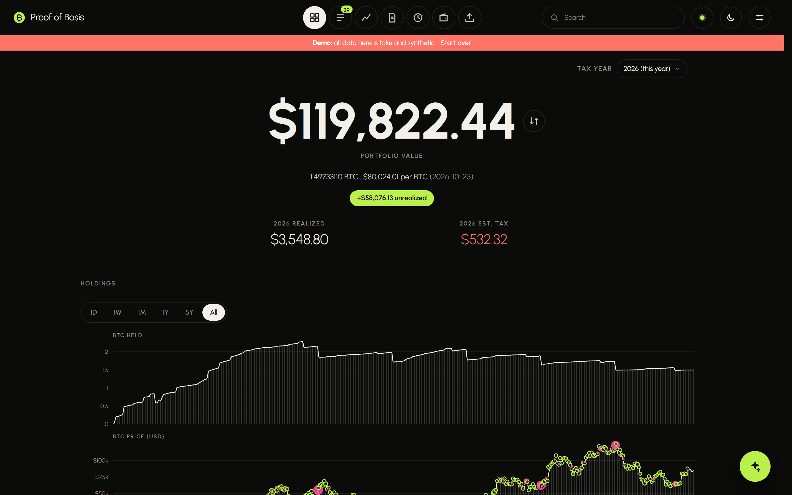
  </picture>
</p>

> **Not tax advice.** Proof of Basis is a self-help tool for organizing your
> records. It is not a CPA, enrolled agent, law firm or tax preparer, and its
> numbers may be incomplete or wrong. You are responsible for your own taxes;
> check everything with a qualified tax professional before you file. See the
> full [Disclaimer](#disclaimer).

---

## How it works

1. **Dump in your exchange history.** Export the CSVs from Coinbase, River,
   Strike and Fold (or a spreadsheet of your own) and drop them all in at
   once. It recognizes each one.
2. **Connect your real wallets.** Paste each wallet's xpub or output
   descriptor. It reads their history from your own node's Electrum server
   (Fulcrum or Electrs), so your addresses never touch anyone else's server.
3. **It untangles everything.** It matches each exchange withdrawal to the
   wallet deposit it became, follows coins from wallet to wallet, and traces
   every sale and spend back to the purchase it came from. Anything it can't
   explain waits in **Review** for you to label.
4. **See where you stand.** The **Overview** shows what you hold, what it
   cost, this year's gains and income, and an estimate of the tax.
5. **Hand your accountant one package.** At tax season, five guided steps
   end in a single download for your tax professional: the Form 8949 lines,
   your 1099-DA forms checked against your records, where every coin came
   from, income, gifts and your proof files.
6. **Ask your own AI.** An optional assistant answers questions about your
   records with a model on your own Ollama server, and can propose fixes for
   you to apply. Nothing leaves your network.

## Why Proof of Basis

- **Private by design.** It reads your wallets through your own node, keeps
  everything in one file on your machine, and never phones home. The package
  for your tax professional leaves out transaction IDs and addresses unless
  you choose to include them.
- **It follows the coins.** Buys on an exchange, withdrawals to cold storage,
  spends from a hot wallet, sales back on an exchange: it links them up, so
  every sale knows which purchase it came from.
- **Ready for tax season.** Five guided steps take you from "is everything
  here?" to a download for your tax professional, with your exchanges'
  1099-DA forms checked against your own records.
- **One click on your node.** Install it from the Umbrel community app store
  or as a StartOS package, and it finds your node's Electrum server and
  Ollama on its own.
- **Works on your phone.** Labeling, the charts and record pages are built
  for a phone screen too.
- **Untangling works anywhere; the tax side is US only.** Matching transfers
  between your accounts, tracing every coin back to the purchase it came
  from, and the Flow and record pages work wherever you live. The tax side
  (gains by US holding periods, Form 8949, the 1099-DA checks, the package
  for your tax professional) follows United States rules, and values are in
  US dollars.
- **In your language.** English, Spanish, French, German, Polish and
  Russian. It follows your browser's language, or pick one in Settings.

---

## Screenshots

These come from the [live demo](https://demo.proofofbasis.degrand.is), so the
data is invented (the red bar says so).

<table>
  <tr>
    <td width="50%">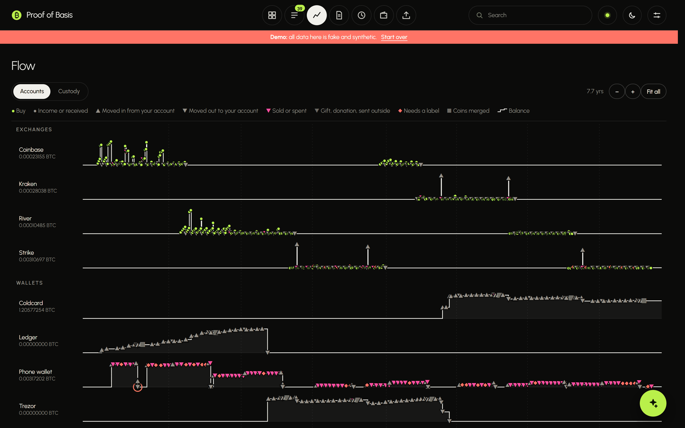<br><b>Flow.</b> Every exchange and wallet as a lane over time, with each buy, transfer, sale and spend on it.</td>
    <td width="50%">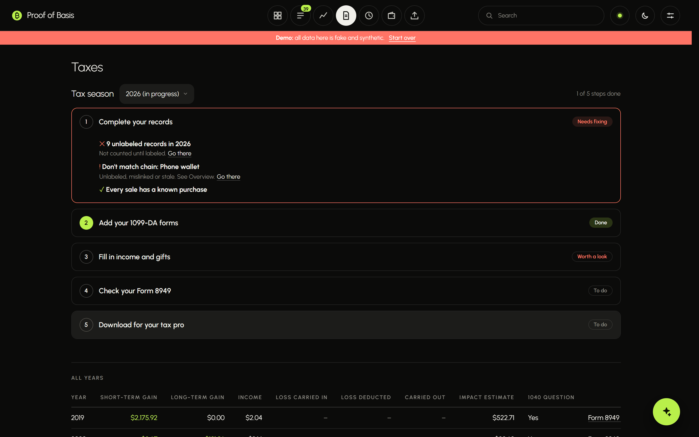<br><b>Taxes.</b> Five steps from "is everything here?" to the download for your tax pro.</td>
  </tr>
  <tr>
    <td width="50%">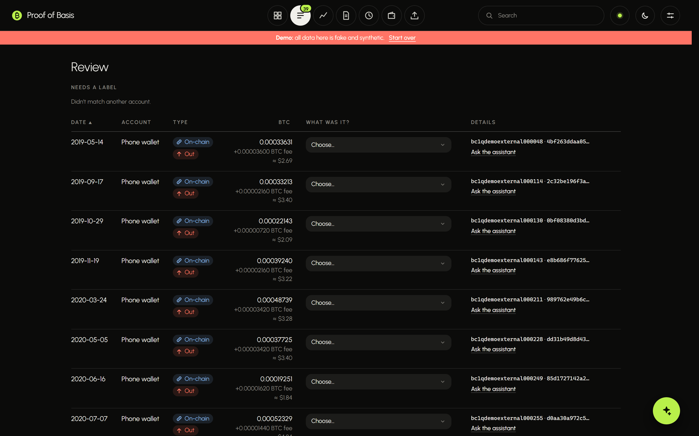<br><b>Review.</b> What it couldn't match on its own, waiting for a label.</td>
    <td width="50%">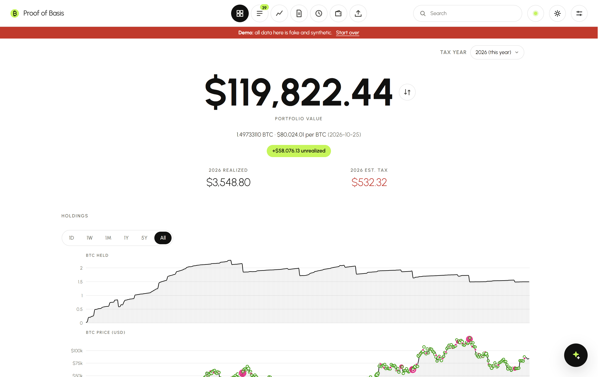<br><b>Light or dark.</b> It follows your system, or pick one.</td>
  </tr>
</table>

On a phone:

<p align="center">
  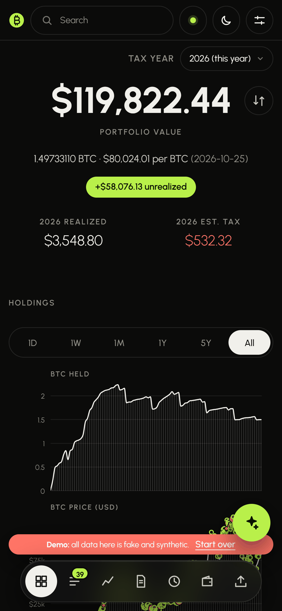
  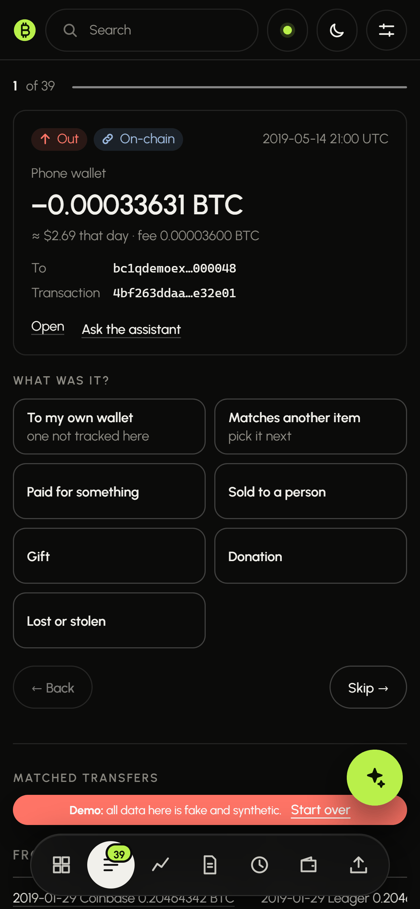
  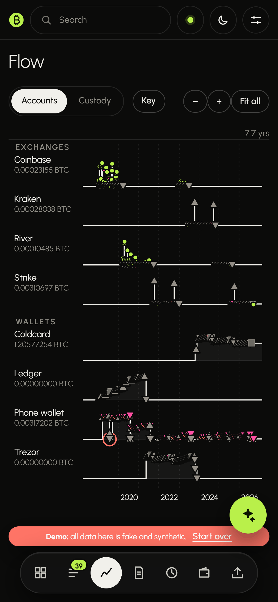
  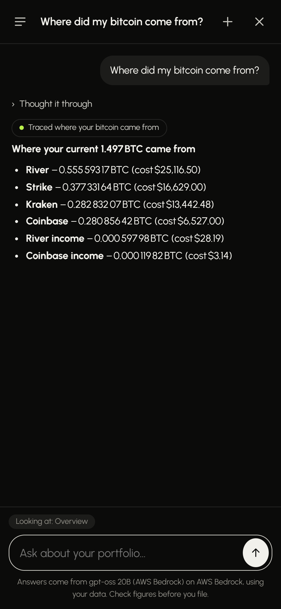
</p>

---

## Ask it anything

The assistant answers from your own records, using any Ollama model that
supports tools on your own server. It doesn't guess from a summary: it looks
things up the way you would, with tools that can

- search your records, and count, total, group or chart them (with a CSV
  download of the rows),
- open any account, transaction or tax year,
- trace coins back to where they came from, or forward to where they went,
- estimate a sale before you make it, by account or by which coins you'd
  sell,
- find coins that turn long-term soon or sit at a loss,
- check your data for problems (stale imports, wallets not scanned lately,
  sales with no purchase behind them),
- look up the BTC price on any day, and do exact math.

**It can also do things, with your OK.** Ask it to label items waiting in
Review, link the two sides of a transfer, or protect a purchase so its coins
are sold last. Each change appears as a card you **Apply** (or dismiss).
Every change, yours or the assistant's, is listed in **Activity** and can be
undone, including by telling the assistant "undo that".

<table>
  <tr>
    <td width="50%">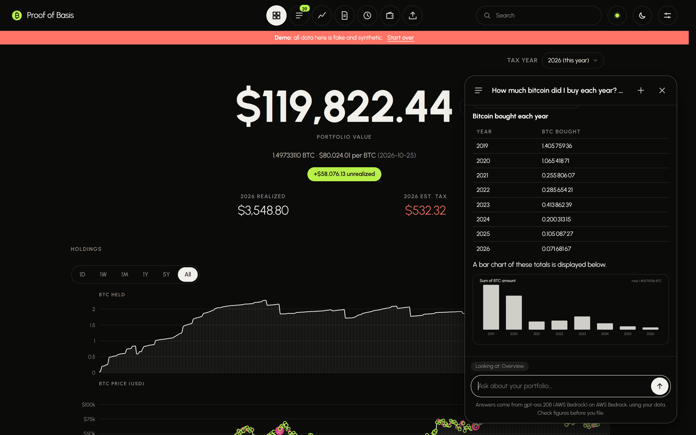<br>"How much bitcoin did I buy each year? Show it as a chart."</td>
    <td width="50%">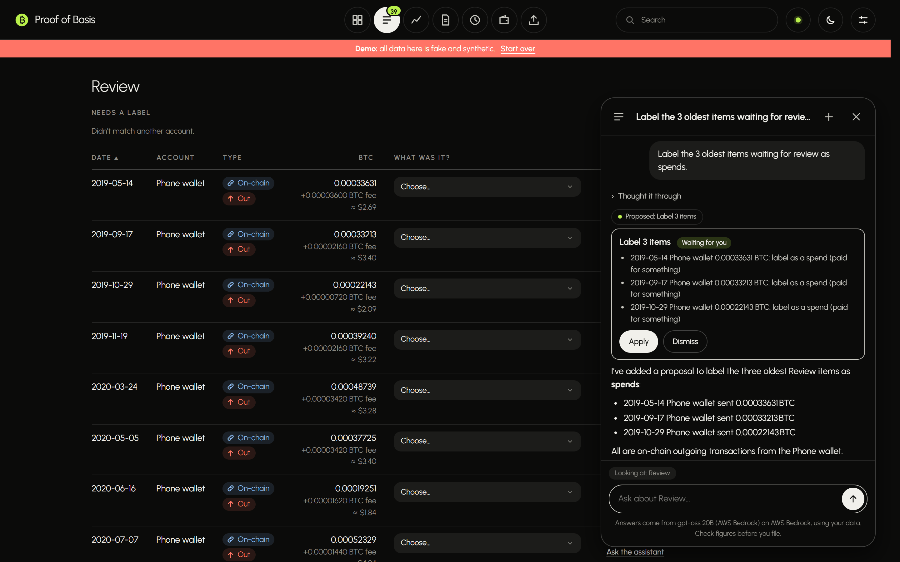<br>"Label the 3 oldest items waiting for review as spends."</td>
  </tr>
</table>

Some things to ask:

| | |
|---|---|
| **Where you stand** | Give me an overview of my bitcoin · How did I get my BTC? · Which exchange did I buy the most on? · What's my average cost per bitcoin? · What's my unrealized gain if BTC goes to $150k? |
| **Digging in** | What was my biggest sale? · Which account did it come from, and how long had I held it? · Where did those coins come from originally? · When did I move my coins from the Ledger to the Trezor? · What did I pay in fees last year? |
| **Taxes and planning** | What was my total tax in 2023? · Compare 2024 and 2025 gains · If I sell 0.1 BTC from my Coldcard today, how much tax would I owe? · How much can I sell this year and keep my tax under $2,000? · Do I have any coins that turn long-term soon? |
| **Cleaning up** | List the items waiting for review · Label the 3 oldest ones as spends · Undo that |

The demo's assistant runs on a hosted model (gpt-oss 20B) so anyone can try
it. Your own install uses your Ollama, and nothing is sent anywhere else.

---

## What you can do

### See where you stand
The **Overview** shows what you hold, what it cost, and how it has changed,
with every buy and sale on the chart. Tap one to see its details. Warnings
point at anything that needs attention, like an account that seems to go
below zero.

<!-- Screenshot: Overview warnings and accounts — docs/images/overview-accounts.png -->

### Label what it couldn't match
Some transactions can't be matched automatically, like a payment to a
merchant or a gift. **Review** lists them. On a phone it shows one at a
time with big buttons ("Paid for something", "Gift", "To my own wallet"…),
and moves to the next as you go.

### Watch your coins move
**Flow** draws each account as a lane over time, with every buy, transfer,
sale and spend on it. Pinch or scroll to zoom. Tap anything to see where
those coins came from and where they went.

### Open any transaction
Every record has its own page: what happened in plain words, the value,
basis and gain (with the % change), each lot the coins came from and the
route they took, the on-chain transaction or the exchange's original CSV
row, and room to attach a receipt or letter as proof.

<!-- Screenshot: A record page — docs/images/record.png -->

### Get ready for tax season
**Taxes** opens on the current tax season and walks you through five steps:

1. **Complete your records.** Everything imported, nothing unlabeled, every
   sale traced to a purchase.
2. **Add your 1099-DA forms.** Drop each exchange's PDF and enter its total.
   It's checked against your records.
3. **Fill in income and gifts.** What kind of income each was, who gifts and
   donations went to, and the January 1, 2025 per-wallet split the IRS now
   expects.
4. **Check your Form 8949.** Every sale in the right box, ready to review.
5. **Download for your tax pro.** One zip with a README for them, the Form
   8949 lines, the 1099-DA PDFs and how each was checked, where every coin
   came from, income, gifts, transfers and your proof files.

### Plan before you sell
**Plan a sale** shows which coins a sale would use, the gain on each, when
short-term coins turn long-term, and a rough tax estimate. You can record
which coins you chose before you sell, as the IRS asks.

### And more
- **Lightning**: connect a Core Lightning node (read-only) to include its
  payments, receipts and routing income.
- **Assistant** (optional): ask questions about your data, using an AI model
  on your own Ollama server. It only changes things when you press Apply.
  See [Ask it anything](#ask-it-anything).
- **Undo anything**: every change (yours or the assistant's) is listed in
  Activity and can be undone.
- **Backups**: one encrypted file with everything, and restore.
- **Light and dark** themes.

---

## Getting started

You need Docker, and a Fulcrum (Electrum) server for your wallets. Most
node packages (Umbrel, Start9, RaspiBlitz, myNode) offer one.

1. **Start it.** In this folder:
   ```sh
   docker compose up -d --build
   ```
   Then open `http://<this computer's address>:8080`.
2. **Set a password.** The first visit asks for one. Do this right away.
3. **Connect your node.** In **Settings**, enter your Fulcrum address and
   port.
4. **Add your wallets.** In **Wallets**, paste each wallet's public key
   (xpub, ypub or zpub) or its output descriptor, and scan.
5. **Import your exchanges.** In **Imports**, drop the CSV exports from your
   exchanges. Several at once is fine.
6. **Label the leftovers** in **Review**.
7. **When tax season comes**, follow the steps on **Taxes**.

<!-- Screenshot: Settings, connecting Fulcrum — docs/images/settings.png -->

### What it supports

| | |
|---|---|
| **Exchanges** | Coinbase, River, Strike, Fold (CSV exports, detected automatically) |
| **Wallets** | Single-key (xpub, ypub, zpub, taproot) and multisig, by public key or output descriptor (Sparrow, Specter, Nunchuk, Bitcoin Core, Electrum, Caravan) |
| **Lightning** | Core Lightning, through CLNRest |
| **Tax rules** | United States only, in US dollars: FIFO, LIFO or specific lot; per-wallet basis from 2025; Form 8949 boxes including the new digital asset boxes; capital loss limit and carryover. Untangling and tracing work for anyone. |
| **Languages** | English, Español, Français, Deutsch, Polski, Русский. Follows your browser's language, or pick one in Settings → Display. |

### Good to know

- **It doesn't file your taxes, and it isn't tax advice.** It organizes and
  documents. Your tax professional prepares the return. See the
  [Disclaimer](#disclaimer).
- **Forgot your password?** On the server, run
  `docker compose exec btctax /btctax reset-password`, then set a new one on
  your next visit. Your data is untouched.
- **Using it away from home?** Put it behind HTTPS (a reverse proxy, or
  Tailscale). Over plain `http://` your password isn't encrypted on the way.

---

## Disclaimer

Proof of Basis is software for organizing your own records, for informational and
educational purposes only.

- **Not professional advice.** It does not provide tax, legal, accounting or
  financial advice. Using it does not create a professional-client
  relationship with anyone.
- **Not a CPA, enrolled agent, law firm or tax preparer.** It does not
  prepare or file tax returns and does not guarantee any tax outcome.
- **Its numbers are estimates.** Basis, gains, income, tax estimates, Form
  8949 lines, 1099-DA checks and the assistant's answers depend on the
  records you give it, outside price data and its own rules. They may be
  incomplete or wrong.
- **You are responsible.** You alone are responsible for checking your
  numbers, knowing current tax law, your filings, and any tax, interest or
  penalties owed. Tax law is complex and changes often.
- **Talk to a professional.** Review your records and tax decisions with a
  qualified CPA, enrolled agent or tax attorney before you file.
- **No warranty.** The software is provided as is, without warranty of any
  kind. Its authors are not liable for any loss arising from its use.

The app shows this on first use, and it is always one click away in the
footer.

---

## Technical details

### Configuration

The program, its settings (`BTCTAX_*`) and its data volume keep the
project's short code name, `btctax`.

| Variable | Default | |
|---|---|---|
| `BTCTAX_ADDR` | `127.0.0.1:8080` (the image uses `0.0.0.0:8080`) | Listen address |
| `BTCTAX_DATA` | `./data` (the image uses `/data`) | Data directory; everything is one SQLite file here |
| `BTCTAX_PASSWORD` | unset | If set, becomes the login password each time the app starts |
| `BTCTAX_ELECTRUM_URL` | unset | The node's Electrum server, `tcp://host:50001` or `ssl://host:50002` |
| `BTCTAX_OLLAMA_URL` | unset | The node's Ollama, `http://host:11434` |
| `BTCTAX_CLN_URL` | unset | The node's Core Lightning CLNRest, `https://host:3010` (the rune is still entered in Settings) |

The last three are for app platforms such as Umbrel and StartOS, which run
the app next to the node's own services: they fill in those settings on a
fresh install, and Settings marks them "Found on your node". A value saved
in Settings always wins. `GET /api/health` answers without a session
(`{"ok":true,"version":"…"}`) for platform health checks.

The app is one static Go binary with the UI embedded; the Docker image adds
it to Alpine Linux (about 10 MB in all), which StartOS needs.
`docker-compose.yml` publishes port 8080 on your LAN and keeps data in the
`btctax-data` volume.

### Login and sessions

The password is stored only as a salted PBKDF2-SHA256 hash. Sessions are
random tokens in an HttpOnly cookie that stay valid for 30 days after last
use, and the cookie is marked secure when served over HTTPS. Repeated wrong
passwords lock out that address for a while. Changing the password signs
out every other device; Settings also has **Sign out everywhere**.
`reset-password` clears the password and all sessions.

### Network and privacy

At runtime the app contacts only:

- your Fulcrum server (wallet scans; its TLS certificate is pinned on first
  use),
- your Core Lightning node, when you sync (optional),
- your Ollama server, when you use the assistant (optional),
- a price source, only when you press **Update prices**.

Exports and the accountant package refer to records by HMAC references
(`R-XXXXXXXXXX`) instead of transaction IDs and addresses, unless you tick
**Include on-chain transaction IDs**. The app can look a reference up.

### Prices

Spends and income need a fair market value. Daily BTC/USD closes come from,
in order: prices you imported or updated, the history built into the binary,
then prices implied by your own trades that day.

The history is committed in `internal/prices/data/btcusd-daily.csv` (from
July 2010). The image build only adds the days since its last one
(`--build-arg PRICE_SOURCE=yahoo` by default, `coinmetrics`, or `none` to
skip), and keeps the file as it is if the source is unreachable. To top up
the committed file, or rebuild it from scratch:

```sh
go run ./cmd/btctax prices fetch -source yahoo -from last
go run ./cmd/btctax prices fetch -source coinmetrics -from 2010-07-17   # then
go run ./cmd/btctax prices fetch -source yahoo -from 2014-09-17         # Yahoo's closes from 2014
```

New sources implement `prices.Source`.

### Matching and basis

- **Tracing**: exchange to wallet, wallet to exchange, wallet to wallet and
  exchange to exchange; by txid, then address (where the amount fits), then
  a unique amount and time, then an amount short by a network fee the export
  folds in or reports only in USD. Exchange sends that confirm up to two
  weeks late still match. A wrong automatic match can be unlinked.
- **Basis**: one pool before 2025, per wallet and account from January 1,
  2025 (Rev. Proc. 2024-28), with the split recorded and confirmable.
  Network fees on your own transfers count as a small sale (IRS FAQs 81 and
  97) or are added to basis, per Settings. Tax years and holding periods
  follow your time zone.
- **1099-DA**: PDFs are stored with their totals; a CSV of 1099-DA lines,
  where an exchange offers one, is matched sale by sale and drives the Form
  8949 boxes and column (g) adjustments.

### Assistant

Settings > Assistant connects a model on your own
[Ollama](https://ollama.com) server. It uses read-only tools to look things
up and proposes changes that happen only when you press Apply. Chats are
saved in the database, included in backups and removed by Wipe; prompts are
never logged.

- Pick a model that can use tools, such as `qwen3:8b`, `llama3.1:8b` or
  `gemma4:e4b`. Settings greys out models that can't.
- If Ollama runs on the same machine as the container, use
  `http://host.docker.internal:11434`. Ollama on another machine must listen
  on the network (`OLLAMA_HOST=0.0.0.0`).
- "Memory for each question" is Ollama's context window. 16k tokens is a
  good start.

### Lightning

Connect Core Lightning in Settings with its CLNRest address and a rune that
can only read the bookkeeper:

```sh
lightning-cli createrune restrictions='[["method=getinfo","method=bkpr-listincome","method=bkpr-listbalances"]]'
```

The rune is stored in the database, never sent back to the browser and
never logged. Payments count as spends at market value and received
payments as income unless you label them otherwise; routing fees are
income; on-chain deposits and withdrawals match your wallets and exchanges.

### Public demo

A public demo for people to try before running their own copy. It is a
separate program (`cmd/btctax-demo`, image target `demo`) around the same
app code, so the app people run carries none of it, and both images are
built from the same commit (`.github/workflows/images.yml` publishes
`ghcr.io/<owner>/<repo>` and `ghcr.io/<owner>/<repo>-demo`, each tagged
with the commit). `docker-compose.demo.yml` runs the demo image.

- Every visitor gets a private copy of an invented history, found again by
  a cookie: seven years of trying exchanges for months at a time (weekly
  buys, dip buys and the odd sale on Coinbase, River, Strike and Kraken),
  savings moved from a Ledger to a Trezor to a Coldcard, and spending from
  a phone wallet. Copies are deleted after 3 idle hours, and all of them on restart.
- No login. Visitors accept the disclaimer, and a red banner says the data
  is fake, with **Start over** for a fresh copy.
- Fulcrum is simulated from the copy's own data, and the Lightning node is
  left out (it isn't finished). The app
  makes no outside connections except the assistant's: node settings,
  price updates, uploads (CSVs, 1099-DA PDFs, proof files), restore, wipe
  and passwords are off.
- The assistant runs on a model in Amazon Bedrock instead of Ollama, with
  20 questions per visitor and 300 per day overall. The default is
  OpenAI's open-weight gpt-oss-20b (`openai.gpt-oss-20b-1:0`), through
  Bedrock's Converse API; any Converse model with tool use works (Amazon
  Nova, for example), and `anthropic.*` IDs go through Anthropic's SDK instead. It
  signs in with the usual AWS credential chain. On EC2 the instance role
  needs `bedrock:InvokeModel` on the model's inference profile and its
  foundation models (Claude models need `bedrock-mantle:CreateInference`
  and Anthropic's one-time use-case form instead), and containers need the
  instance metadata hop limit set to 2. Without credentials the demo runs
  with the assistant off.

| Variable | Default | |
|---|---|---|
| `AWS_REGION` / `BTCTAX_BEDROCK_REGION` | `us-east-1` | Bedrock region |
| `BTCTAX_BEDROCK_MODEL` | `openai.gpt-oss-20b-1:0` | Bedrock model ID |
| `BTCTAX_DEMO_AI` | `true` | `false` turns the assistant off |
| `BTCTAX_DEMO_AI_PER_VISITOR` / `_PER_DAY` | `20` / `300` | Assistant questions allowed |
| `BTCTAX_DEMO_MAX_COPIES` / `BTCTAX_DEMO_IDLE_HOURS` | `100` / `3` | Visitors' copies kept, and for how long idle |

### Images and CI

`.github/workflows/images.yml` runs on every push to `master`: vet and
tests (including the demo's, which walk every screen's data in a demo
copy), a check that the app's program imports no demo code, then both
images built with the Actions layer cache and published to GitHub's
container registry as `ghcr.io/<owner>/<repo>` and `ghcr.io/<owner>/<repo>-demo`,
tagged `:<commit>` and `:latest`. The app image is built for `linux/amd64`
and `linux/arm64` (Go cross-compiles, so no emulation); the demo for
`linux/amd64` only. Pushing a version tag (`git tag v1.2.3`) also publishes
the images as `:1.2.3`, with the version stamped into the app, for the
Umbrel and StartOS packages to pin. The names follow the repository, and the
run's own token publishes them, so no secrets are needed. Pull requests
run the same steps without pushing.

```sh
docker build -t btctax .                       # the app (default target)
docker build --target demo -t btctax-demo .    # the demo
```

### Development

```sh
go test ./...                       # unit tests, synthetic data only
go run ./cmd/btctax -addr 127.0.0.1:8080
```

A demo with a large invented history (seven years, three exchanges, four
wallets) for trying the UI. It only writes to an empty database:

```sh
docker volume create btctax-demo
docker run --rm -v btctax-demo:/data btctax:latest demo -data /data
docker run --rm -p 127.0.0.1:8081:8080 -v btctax-demo:/data btctax:latest
```

End to end on a throwaway regtest chain (bitcoind and Fulcrum in Docker):

```sh
test/regtest/up.sh
test/regtest/scenario.sh ./out      # plays a synthetic buy/withdraw/spend/deposit/sell story, prints a tpub
# Settings: Fulcrum 127.0.0.1:50002 TLS (or 50001 plain), Network: Regtest
# Add the printed tpub as P2WPKH, scan, import ./out/*.csv
```

`test/regtest/lightning.sh` adds two throwaway regtest Lightning nodes.

**Never commit real exports.** Test fixtures are invented; `*.real.csv` and
`private/` are git-ignored for local testing.

### Layout

```
cmd/btctax          the app
cmd/btctax-demo     the public demo (same app, demo mode)
internal/wallet     extended keys, descriptors, address derivation, Electrum script hashes
internal/electrum   minimal Electrum protocol client
internal/scan       gap-limit wallet scan, per-transaction summaries
internal/importers  CSV handlers per platform, 1099-DA lines
internal/trace      matching exchange records to chain activity, the Review queue
internal/lots       cost-basis engine
internal/tax        jurisdiction rules (US)
internal/prices     price sources (Yahoo, Coin Metrics) and the built-in history
internal/store      SQLite persistence
internal/app        HTTP API, report, tax forms, accountant package, assistant, demo mode
internal/claude     the demo's assistant on Claude in Amazon Bedrock
internal/converse   the demo's assistant on other Bedrock models (Llama, Nova)
internal/sandbox    the public demo: a private copy per visitor
web/static          UI (plain JavaScript, no build step)
```
